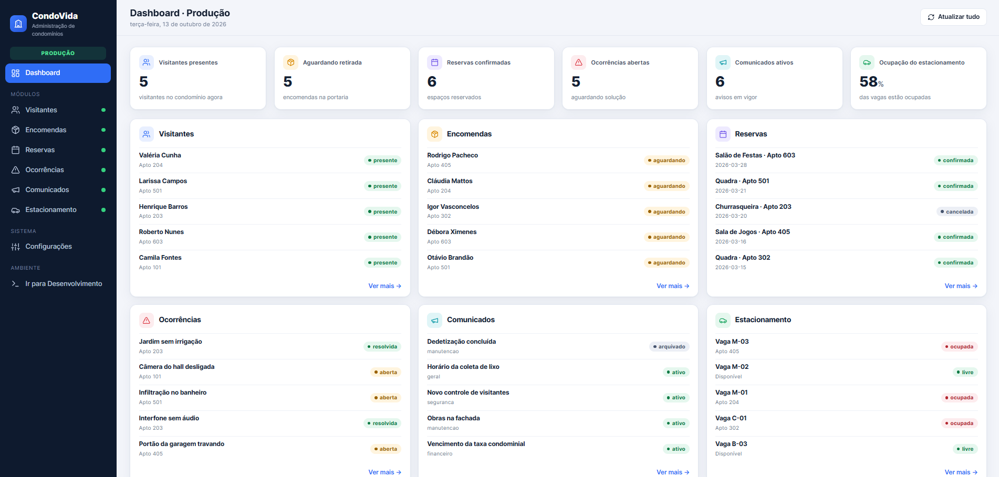
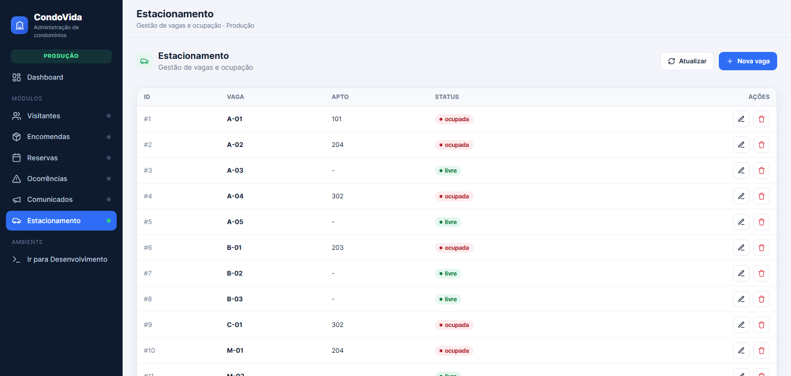
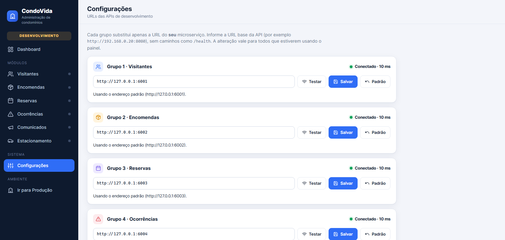

# Desafio: migre a API legada do CondoVida para Spring Boot

Bem-vindos ao desafio! A **CondoVida** é uma empresa de administração de
condomínios. O sistema dela funciona, mas o código-fonte original se perdeu e a
empresa precisa migrá-lo para **Java com Spring Boot**. Vocês foram contratados
para essa migração.

O sistema é dividido em seis microsserviços independentes e um painel
administrativo que os consome. Existem duas telas do painel:

- **Produção** (`/`): o sistema legado em operação. É o seu ponto de partida e
  funciona perfeitamente.
- **Desenvolvimento** (`/dev`): o mesmo painel, ligado às APIs **que vocês vão
  construir**. No início ela está quebrada (ou incompleta). A atividade termina
  quando a tela de desenvolvimento se comporta como a de produção.

Cada grupo migra **um** microsserviço e, quando a sua API Java estiver pronta,
aponta a tela de desenvolvimento para ela na página `/config`.



## Objetivo

Criar, com Spring Boot, uma API **idêntica** à API de produção do seu grupo:
mesmas rotas, mesmos métodos HTTP, mesmos nomes de campos e mesmo formato de
JSON, funcionando com a tela de desenvolvimento **sem nenhuma alteração no
frontend**.

Não existe código-fonte nem documentação do legado. O único jeito de descobrir
como a API se comporta é **observá-la**.

## Organização dos grupos

| Grupo | Microsserviço | Responsabilidade |
| --- | --- | --- |
| 1 | Visitantes | Controle de visitantes e acessos |
| 2 | Encomendas | Recebimento e retirada de encomendas |
| 3 | Reservas | Reservas de espaços comuns |
| 4 | Ocorrências | Registro e acompanhamento de ocorrências |
| 5 | Comunicados | Publicação de avisos do condomínio |
| 6 | Estacionamento | Gestão de vagas e ocupação |

Cada grupo cuida apenas do seu serviço. Os serviços não se comunicam entre si:
quem integra os seis módulos é o painel.

## Como a atividade funciona

1. O professor entrega o **endereço do painel**, algo como `http://IP-DO-PROFESSOR:8000`
   (computador do professor, na mesma rede de vocês). Nele:
   - `/` é a tela de **produção**;
   - `/dev` é a tela de **desenvolvimento**;
   - `/config` é a página onde vocês cadastram a URL da API de vocês.
2. Cada grupo usa o módulo do seu serviço na tela de **produção** e investiga a API.
3. Cada grupo cria um projeto Spring Boot e reproduz o comportamento.
4. Cada grupo cadastra a URL da sua API na página `/config`.
5. O grupo confere o módulo na tela de **desenvolvimento** e vai corrigindo a API até
   que fique igual ao de produção. O professor valida ao vivo.

## Preparando o ambiente

Vocês precisam de **JDK 21**, do **VS Code** com o *Extension Pack for Java* e o
*Spring Boot Extension Pack*. O Gradle vem junto com o projeto (`gradlew`).

Criando o projeto (como visto em aula):

1. No VS Code, `Ctrl + Shift + P` e escolha **Spring Initializr: Create a Gradle Project...**
   (ou use <https://start.spring.io/>).
2. Escolha a versão estável mais recente do Spring Boot, linguagem **Java**,
   empacotamento **Jar** e o Java 21.
3. Informe o *Group Id* (por exemplo `com.example.labprog`) e o *Artifact Id*
   (por exemplo `visitantes`).
4. Adicione a dependência **Spring Web**.
5. Rode o projeto:

   ```powershell
   .\gradlew.bat bootRun
   ```

   Linux, macOS ou WSL: `./gradlew bootRun`.

A API sobe na porta `8080`. Para usar outra porta:
`.\gradlew.bat bootRun --args='--server.port=8081'`.

## Investigação

A tela de **produção** é o seu manual. **Tudo o que a API faz pode ser feito pela
interface** e cada clique gera uma requisição HTTP real.

1. Abra o módulo do seu grupo e aperte `F12` para abrir as **ferramentas de
   desenvolvedor**.
2. Vá para a aba **Network** (Rede) e filtre por **Fetch/XHR**.
3. Use a interface: recarregue a página, crie, edite e exclua registros. Volte
   à dashboard e observe o que ela pede ao seu serviço.
4. Clique em cada requisição e examine:
   - **Headers**: método, URL e código de status;
   - **Payload**: o JSON enviado;
   - **Response**: o JSON recebido.



Para repetir e variar as requisições, usem o **Postman**, o **Insomnia** ou a
opção "Copy as cURL" do DevTools.

Perguntas que vocês devem responder para o seu serviço:

- Quais rotas e métodos existem? O que cada uma devolve?
- Quais campos tem cada objeto e que tipo de valor eles guardam?
- Quais são os registros que o serviço já tem quando inicia?
- Que id um registro novo recebe? O que cada operação devolve?
- A dashboard mostra **um número** que não é um registro. De onde ele vem? A
  qual rota o painel pede esse número e como ele é calculado a partir dos dados?

## O que vocês vão implementar

Cada serviço tem quatro operações básicas sobre os seus registros (listar,
criar, atualizar e excluir) e **um endpoint consolidado**.

Um **endpoint consolidado** não devolve registros: ele devolve um **resultado
calculado pelo servidor** a partir dos registros que ele guarda (uma contagem, um
percentual...). É o tipo de informação que um cliente pediria pronta em vez de
baixar a lista inteira e contar sozinho. Na dashboard do painel, esse resultado
aparece como o grande número do seu serviço. Descubram qual é o cálculo
observando o número e a lista de registros.

Reproduzam tudo usando o que vimos em aula:

- uma classe para o objeto (atributos privados, construtor, getters e setters),
  como a `User` do exercício de usuários;
- um `@RestController` com um método para cada rota observada
  (`@GetMapping`, `@PostMapping`, `@PutMapping`, `@DeleteMapping`,
  `@PathVariable`);
- os dados em um `ArrayList`, iniciando com os mesmos registros do legado, e
  percorrido com `for` e `if`;
- o resultado consolidado devolvido como um `HashMap`, como no exercício do
  fatorial.

### Dicas (o que ainda não vimos)

Para o método **receber o JSON** enviado pelo painel, o parâmetro recebe
`@RequestBody`. Para o navegador **aceitar as respostas** da sua API a partir do
painel (CORS), coloque `@CrossOrigin` na classe do controller. Não é preciso
validar nada: o painel só manda dados de teste.

Detalhes que costumam dar problema:

- A classe do objeto precisa de **getters** (para o JSON de saída) e de um
  **construtor sem parâmetros** além do construtor completo (para o JSON de entrada).
- O nome do campo no JSON é o nome do atributo/getter. Confira maiúsculas e
  minúsculas com o que você viu na aba Network.
- O `id` de um registro novo é gerado pela API, não pelo painel.
- Uma rota com `@PathVariable` usa o mesmo nome entre chaves e no parâmetro:
  `"/exemplo/{id}"` e `@PathVariable("id")`.

## Regras gerais (valem para todos os grupos)

- Receber e devolver **JSON**, com os nomes de campos **exatamente** como o
  legado (maiúsculas e minúsculas incluídas).
- Manter os dados **em memória**. Não usem banco de dados.
- Não chamar outras APIs e não depender de outros serviços.
- Implementar `GET /health` respondendo, em JSON, o **mesmo conteúdo** que a API
  de produção do seu grupo devolve (abra `<URL da API de produção>/health` no
  navegador).

## Integração

1. Rode a sua API (`gradlew bootRun`) e teste com o Postman em
   `http://localhost:8080/...`.
2. Torne-a acessível ao painel, que roda no computador do professor:
   - descubra o **IP do seu computador** na rede (`ipconfig` no Windows, procure o
     "Endereço IPv4"; `ifconfig` ou `ip a` no Linux/macOS);
   - a URL da sua API será `http://SEU-IP:8080` (troque a porta se mudou). Teste-a
     em outro computador ou no celular, na mesma rede, abrindo
     `http://SEU-IP:8080/health`;
   - se não abrir, o **firewall** está bloqueando: no Windows, permita o Java
     (ou a porta da API) em redes privadas;
   - todos precisam estar na **mesma rede** do professor. Se não for possível, usem
     algum serviço de túnel ou publiquem em um servidor (pesquisem as opções).
     Atenção: um painel aberto por HTTPS só chama APIs HTTPS.
3. Abra a página **`/config`** do painel (ela configura a tela de **desenvolvimento**).
   Ela mostra os seis serviços:

   

4. No cartão do **seu** grupo, cole a **URL base** (sem caminhos como `/health`
   ou `/visitantes`), clique em **Testar** e, se estiver conectado, em **Salvar**.
5. A URL fica guardada no servidor do painel: vale para todos e continua salva
   se o painel for reiniciado. O botão **Padrão** volta para o endereço original.
6. Abra a tela de **desenvolvimento** (`/dev`), o módulo do seu grupo e a dashboard, e
   compare com a produção.

**Altere somente a URL do seu grupo.**

## Problemas comuns

| Sintoma | O que verificar |
| --- | --- |
| "Testar" falha em `/config` | API não está rodando; IP ou porta errados; firewall; URL com caminho (`/health`) ou com `https` |
| Card mostra "API indisponível" | mesmo que acima; ou a API caiu (veja o terminal do Gradle) |
| Erro de CORS no console do navegador (`F12` > Console) | falta `@CrossOrigin` no controller |
| Lista aparece vazia ou com campos em branco | nomes dos campos diferentes dos da produção; falta construtor vazio ou setters |
| Criar ou editar não funciona | o corpo (`@RequestBody`) não chegou como esperado; compare o *Payload* com o da produção na aba Network |
| O número consolidado não bate com o da produção | revise o cálculo e quais registros entram nele |
| A porta 8080 já está em uso | use `--server.port=OUTRA` e atualize a URL em `/config` |
| Erro depois de trocar a URL | confira que a URL foi **salva** (botão Salvar) e recarregue a tela de desenvolvimento |

Dica: na aba Network, marque **Preserve log** e **Disable cache**, e compare lado a
lado a requisição da produção com a da desenvolvimento.

## Critério de sucesso

A tela de **desenvolvimento** deve funcionar exatamente como a de **produção** com a
**sua** API Java, **sem nenhum ajuste no frontend**:

- a dashboard mostra o número consolidado e os últimos registros do seu serviço;
- listar, criar, editar e excluir funcionam;
- depois de criar, editar ou excluir, o número consolidado muda de acordo;
- o professor consegue repetir as chamadas do legado e obter as mesmas respostas.

Boa migração!
